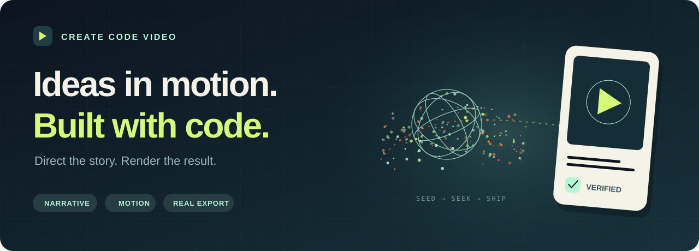

<p align="center">
  
</p>
<h1 align="center">Create Code Video</h1>
<p align="center"><strong>Videos built with code. Delivered as files.</strong></p>
<p align="center">An agent skill for narrative, motion design, sound, and verified video exports.</p>
<p align="center">
  <strong>English</strong> · <a href="README.zh-CN.md">简体中文</a>
</p>
<p align="center">
  <a href=".github/workflows/validate.yml"></a>
  <a href="LICENSE"></a>
  <a href="CHANGELOG.md"></a>
  
</p>
<p align="center">
  <a href="#quick-start">🚀 Quick start</a> · <a href="#see-it-in-motion">▶ Demo</a> · <a href="#documentation">📖 Docs</a> · <a href="CONTRIBUTING.md">🛠 Contribute</a>
</p>
<p align="center"></p>

Turn a technical idea, product comparison, or data story into a video with a clear point and deliberate motion. This skill guides an agent from research and shot direction to a playable **MP4 and reproducible source project**.

It is a production workflow, with runnable examples and checks. Rendering uses tools such as Remotion or HyperFrames. Visuals are drawn or arranged with code by default; no video or image generation model is required.

Narrated videos include **TTS selection, voice direction, audio-aligned captions, and opening/ending delivery**. Covers and publishing copy are planned at the start when needed. The standalone Motion Lab below focuses on rendering mechanics; its audio setup does not define the production workflow.

## See it in motion

<p align="center">
  
</p>
<p align="center"><strong>Input → handoff → evidence → hold</strong><br />18 seconds · 9:16 · silent · original code-drawn graphics</p>

[Run the Motion Lab](examples/remotion-motion-lab/README.md) to export the full 1080×1920, 30fps MP4. The GIF is a 360px / 10fps preview generated from the corrected export. Its timing, every frame's conversion fidelity, and source freshness are checked by [the preview tool](scripts/build_preview.py).

## What it covers

| | Production decision | Included support |
| --- | --- | --- |
| 🎬 **Story & direction** | One core topic; shots that show a cause and a result | Shot specification, persistent objects, reading holds |
| ✨ **Motion & space** | Transitions with a purpose; particles and cameras with a shared clock | Frame-synced Three.js shaders, seeded data, seekable GSAP example |
| 🎨 **Layout & identity** | Legible mobile typography; meaningful logos, interfaces and characters | Reserved caption regions, measured layout contracts, asset records, separate covers |
| 🎙 **Voice & delivery** | Pick a usable TTS route; direct curiosity, explanation, emphasis and closure | Provider comparison, consistent references, same-script samples, alignment and whole-track loudness |
| 🖼 **Publishing package** | Confirm covers and copy early; package a clear, accurate topic | Intake brief, independent cover design and platform copy guidance |
| ✅ **Export & verification** | Real deliverables, with evidence of what was checked | MP4 probing/decoding, frame captures, negative layout cases, preview provenance |

## Voice and publishing

The [TTS guide](references/tts-selection.md) distinguishes local inference, limited cloud APIs and free previews. It records the actual case progression: Edge draft → Qwen Vivian/Serena samples → the user's Vivian choice → fixed-reference Qwen Base synthesis in semantic paragraphs. Other providers are documented candidates, not claimed listening-test winners.

[Voice direction](references/voice-and-sound.md) separates speaker identity, performance and spoken text. It gives practical directions for the opening, explanation, turn and final sentence, plus sample comparison, paragraph continuity, audio alignment and mixing. A passing ASR or loudness check is not a listening verdict.

At the beginning of a new production, the agent [confirms missing cover/copy preferences](references/publishing-package.md) while continuing independent work. Existing choices carry forward. A cover can have its own style; its topic and publishing copy must still match the video. Editable [production brief](examples/production-brief.example.json) and [voice direction](examples/voice-direction.example.json) records help preserve decisions.

## Quick start

### 1. Install the skill

```bash
git clone https://github.com/Yankj/create-code-video.git
mkdir -p ~/.codex/skills/create-code-video
cp -R create-code-video/SKILL.md create-code-video/agents \
  create-code-video/assets create-code-video/references \
  create-code-video/scripts create-code-video/examples \
  ~/.codex/skills/create-code-video/
```

Keep a backup if you have a customized version. Other agents that support `SKILL.md` can use their own skills directory. Reading the skill does not require installing the example dependencies. Refresh the skill list or start a new session.

### 2. Give it a topic and a deliverable

```text
$create-code-video Make a 9:16 technical short about how a personal agent
finishes a long-term goal. Show execution, observation, correction, and
verification. Use code-drawn motion graphics and a conversational female
voice. Deliver the MP4, source, cover, and publishing copy.
```

An existing conversation can supply the topic, audience, references and preferences. The agent should continue to an actual file when a finished video is requested.

### 3. Run the standalone example

Requires **Node.js 22+** and npm. The first render needs a browser download. No external image, model or TTS service is called by this example.

```bash
cd create-code-video/examples/remotion-motion-lab
npm ci
npm test
npm run typecheck
npm run frames   # rendered layout checks + deliberate failure cases
npm run render   # out/motion-lab.mp4
npm run verify-export # decode + encoded/still agreement; needs Python/Pillow/ffmpeg
```

Use `npm run studio` to edit and `npm run smoke` for a short draft. The example uses software WebGL by default. Browser overrides and font requirements are documented in the [example guide](examples/remotion-motion-lab/README.md).

## Layout and preview safeguards

**A layout contract connects the design to the rendered result.** The Motion Lab uses one design plane, explicit typography and card sizes, a dedicated 3D viewport, and a protected caption area. After fonts load, each rendered frame checks transformed DOM bounds, text overflow, card containment and caption clearance. A violation stops the export. Deliberately broken layouts verify that the guard rejects errors.

**A preview belongs to a particular export and source.** `npm run preview:build` runs frame checks, full export, decoding and encoded/still comparison before rebuilding the GIF.  The GIF builder compares every frame against the same sampled MP4, checks geometry and loop timing, and stores source/asset hashes. CI rejects a stale or altered preview. Conversion checks establish fidelity to the source; they do not judge whether the source is well directed.

These rules are configurable. This example's 9:16 coordinates and spacing are not universal platform requirements. Another aspect ratio needs a new layout.

## Documentation

| Guide | Use it for |
| --- | --- |
| [Skill entry](SKILL.md) | Task routing and the complete workflow |
| [Story & direction](references/story-and-direction.md) | Core topic, shot purpose and motion hierarchy |
| [Layout & assets](references/layout-and-assets.md) | Mobile typography, layout guards, identity and covers |
| [TTS selection](references/tts-selection.md) · [Voice direction](references/voice-and-sound.md) | Providers, actual case settings, human delivery, continuity and audio-aligned captions |
| [Publishing package](references/publishing-package.md) | Early cover/copy choices and platform-ready deliverables |
| [Transitions](references/transitions.md) · [3D & particles](references/three-and-particles.md) | Continuity, camera movement, shaders and GPU lifecycle |
| [Render & QA](references/render-and-qa.md) | Capture, export, media inspection and preview checks |
| [Remotion example](examples/remotion-motion-lab/README.md) · [GSAP seek example](examples/hyperframes-seek/README.md) | Runnable implementation starting points |
| [Research & attribution](references/research-and-attribution.md) | Upstream revisions, borrowed methods and license boundaries |
| [Validation record](VALIDATION.md) · [Changelog](CHANGELOG.md) | What was measured and what changed |

<details>
<summary><strong>Repository checks</strong></summary>

From the repository root, install Pillow for image/preview utilities. Media checks need ffmpeg and ffprobe on `PATH`.

```bash
python3 -m pip install Pillow
python3 scripts/check_skill.py
python3 scripts/build_preview.py --check assets/motion-lab-preview.json
python3 -m unittest discover -s tests -v
python3 scripts/validate_storyboard.py examples/storyboard.example.json
python3 scripts/qa_video.py examples/remotion-motion-lab/out/motion-lab.mp4 \
  --width 1080 --height 1920 --fps 30 --duration 18
```

GitHub Actions checks documents, preview freshness, Python utilities, deterministic logic and TypeScript. Rendered GPU/layout checks are run through `npm run frames`; full rendering and artistic review are separate. See [validation boundaries](VALIDATION.md).

</details>

## Scope and license

TTS services, model weights and voice references are selected in the production environment rather than bundled in this repository. The guides record capabilities and tested case settings, not a permanent ranking of naturalness. Fonts use local fallback in the demo, so typography may differ across systems. Production projects should package a permitted font and verify its actual bounds. The guard catches declared layout violations; visual inspection still matters.

Original instructions, tools and examples use the [MIT license](LICENSE). Dependencies and third-party assets retain their own terms, including [Remotion's license](https://www.remotion.dev/license). Upstream skills were researched, not copied or relicensed.

Contributions work best with a concrete shot, a rendered failure, or a reproducible improvement. See [CONTRIBUTING.md](CONTRIBUTING.md).
